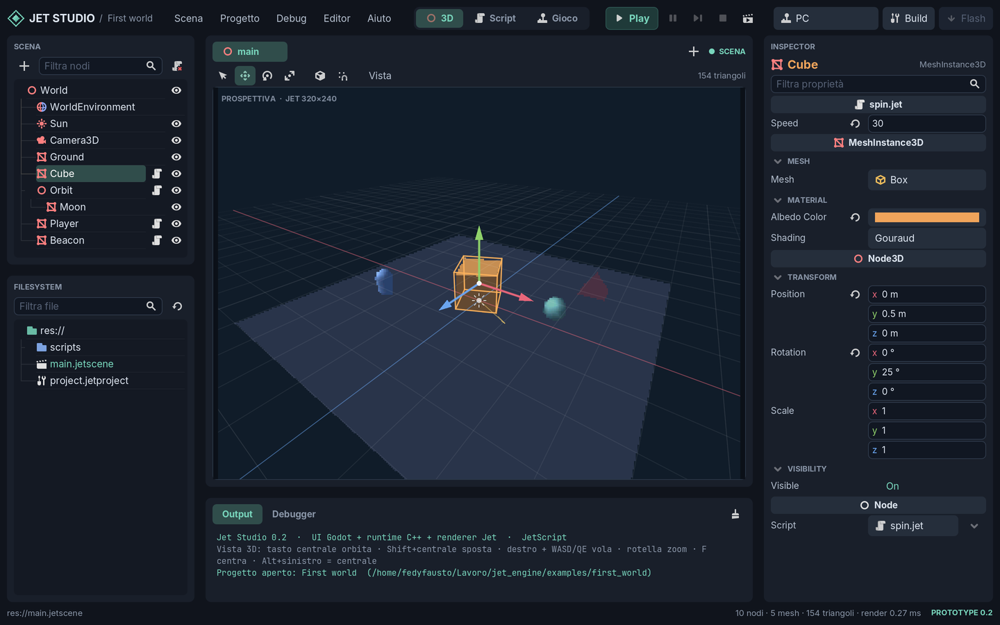
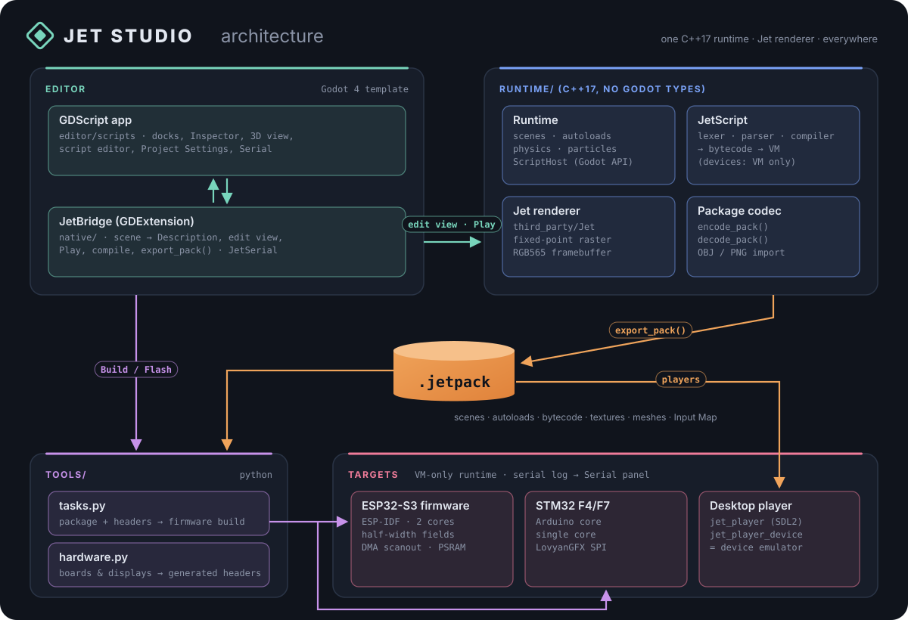
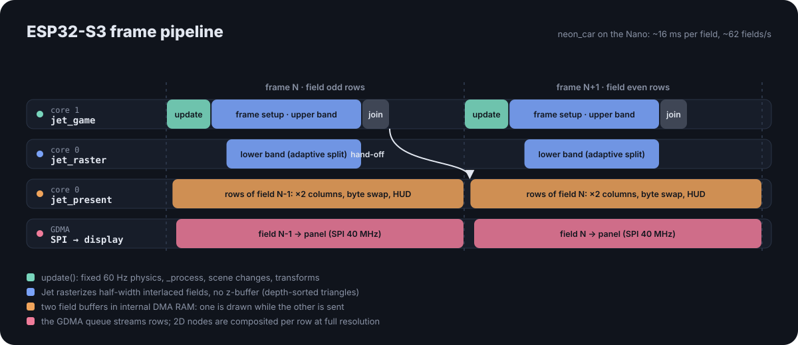

# Jet Studio - prototype 0.2

A **Godot**-style 3D desktop editor, built with Godot's UI, with an **independent C++17** game
runtime, the **Jet** renderer and the **JetScript** scripting language (GDScript syntax). The
same runtime runs in the editor, in the SDL2 desktop player and on the Arduino Nano ESP32
firmware.



## Running

```sh
./jet-studio run
```

On first launch the editor opens the example project `examples/first_world`; after that it
reopens the last project, with the scenes and scripts that were left open. `Project > Project
Manager` creates or opens other projects.

On Wayland the launcher uses the native Wayland driver: with GNOME fractional scaling the
interface is drawn at the screen's real resolution (under XWayland it would be upscaled and
blurry). `JET_STUDIO_DISPLAY=x11 ./jet-studio run` forces X11. When launched from the terminal
of a snap app (e.g. VS Code), the launcher removes the snap's GTK/GLib variables, which would
otherwise make the Wayland driver terminate. The interface scale is changed from the `Editor` menu.

## Layout (like Godot)

- **Top bar**: Scene/Project/Debug/Editor/Help menus, **3D · Script · Game** screens,
  Play (F5), Play current scene (F6), Pause (F7), Stop (F8), target, Build, Flash.
- **Scene** (top left): node tree. `+` or Ctrl+A opens *Create New Node*; drag nodes to
  reparent them (the global transform is kept); double-click or F2 renames; Ctrl+D duplicates;
  Delete deletes; eye icon = visibility; script icon = open script.
- **FileSystem** (bottom left): the contents of `res://`. Double-click opens scenes and scripts;
  the context menu creates scripts/scenes/folders, renames, duplicates, deletes (to the trash)
  and sets the main scene. Drag a `.jet` onto a node to attach it. Selecting a PNG or an OBJ
  shows its **import settings** in the Inspector (like Godot's Import dock), saved next to the
  file in `name.png.import` / `name.obj.import`; "Reimport" applies them.
- **Inspector** (right): categories per class (MeshInstance3D, Node3D, Node…), collapsible
  groups, draggable numeric fields (Shift for precision, Ctrl for snapping, click to type a
  value or an expression), a button that reverts to the default value, a property filter and the
  `@export` variables of the attached script. A drag produces a single undo step.
- **Output / Debugger / Serial** (bottom): messages, `print()` output from scripts, errors with
  links to the line, and the board's serial monitor (see below).

## Nodes

| Class | Use |
| --- | --- |
| `Node` | organization, global logic |
| `Node3D` | transform (position, rotation in degrees YXZ, scale); children inherit it |
| `MeshInstance3D` | Box, Sphere, Plane, Pyramid, Cylinder, Capsule, Quad, Torus primitives (Godot's default sizes) or a part of an OBJ model (`File`), and material (see below) |
| `Camera3D` | vertical FOV, near/far, `current` |
| `DirectionalLight3D` | color and energy; lights along its own −Z |
| `WorldEnvironment` | background (color, sky/ground gradient, panorama) and ambient light |
| `Label` | 2D text over the scene, the runtime's 7×15 bitmap font (Latin with accents), integer scale |
| `TextureRect` | 2D PNG image, integer scale or free size, transparent key color |
| `ColorRect` | solid or semi-transparent rectangle (fades, bars, panels) |
| `StaticBody3D` | collides and does not move on its own (scripts can move it: moving platforms) |
| `CharacterBody3D` | character moved by the script with `move_and_slide()` |
| `RigidBody3D` | body with gravity, mass, bounce, friction and impulses |
| `Area3D` | reports bodies that enter and exit (coins, triggers, zones) |
| `CollisionShape3D` | Box, Sphere or Capsule collision shape, child of a body or an area |
| `CPUParticles3D` | particle emitter (sparks, splashes, fountains) using Jet's particle system |

2D nodes (`Control`) use 320×240 screen pixels; the position is relative to the parent Control.
They have opacity and visibility, are selected by clicking them in the viewport and are moved by
dragging them (Y = 8 px snap); from scripts: `text`, `color`, `position`, `size`, `alpha`.

### Physics

"Arcade" physics with Godot's nodes and API, designed for the ESP32: fixed 60 Hz step,
`_physics_process(delta)` before `_process`, Box/Sphere/Capsule shapes (with the node's scale),
`collision_layer`/`collision_mask` as in Godot.
- **CharacterBody3D**: `velocity`, `move_and_slide()` (slides along walls, stays still on
  slopes below `floor_max_angle`, snaps to the ground when going down, is carried by moving
  platforms, pushes RigidBody3D nodes), `is_on_floor()`, `is_on_wall()`, `is_on_ceiling()`,
  `get_floor_normal()`. Godot's template script works as is.
- **RigidBody3D**: `mass`, `gravity_scale`, `bounce`, `friction`, `linear_velocity`,
  `angular_velocity`, damping (plus Godot's default 0.1), `freeze`, `sleeping`,
  `apply_central_impulse()`, `apply_impulse()`, `apply_central_force()`. Spheres roll; boxes
  do not tip over. Bodies that have been at rest for half a second go to sleep and cost nothing.
- **Area3D**: `_on_body_entered(body)` / `_on_body_exited(body)` in the area's script (the
  names Godot gives to connected signals), `get_overlapping_bodies()`, `overlaps_body()`.

In the 3D viewport shapes are drawn in light blue. `examples/physics_demo` (generated by
`./jet-studio examples`) uses all of them: a character that jumps, a ramp, a moving platform,
crates to push, bouncing balls and coins to collect (with particles: a fountain and sparks for
each coin collected). On the Nano the demo (63 nodes, 34 shapes,
5 scripts) costs about 2.6 ms of script and physics per frame and runs at ~53 fields per second,
limited by drawing.

As in Godot, a body or an area without a `CollisionShape3D` does not collide (it falls through
the floor): the Scene dock flags it with the warning icon and Play reports it in the Output.
Bounce and friction combine as in Godot (bounces are added, up to 1; the lower friction wins).

### Particles

`CPUParticles3D` uses Godot's properties: `emitting`, `amount` (up to 200, Jet's fixed pool),
`lifetime`, `one_shot`, `explosiveness`, `lifetime_randomness`, `emission_shape` (Point,
Sphere, Box), `direction` and `spread` (cone), `gravity`, `initial_velocity_min/max`,
`damping_min/max`; from scripts also `restart()`. Emission and simulation follow Godot's cycle:
direction and cone apply to the initial velocity, so with velocity 0 the particles move only
under gravity, all along the same line. Drawing styles:
- **Sparks** and **Water**: Jet's `ParticleSystem`, a streak oriented along the velocity
  (white-hot cooling to blue, optionally additive; foam turning blue), with Jet's colors;
- **Puff** (ours): soft discs that grow (`puff_size` → `puff_size_end`), shift from `color` to
  `color_end` and fade from `alpha` to 0: smoke, dust, steam, painted directly into the field
  (half width, field rows).

Particles behind an opaque mesh are hidden: on the PC with the z-buffer, on the device (which
has no z-buffer) with a depth map of 4×4-pixel cells built from the opaque meshes near the
particles (front faces only, as Jet draws them; rebuilt every other frame). Meshes with
Draw Order Background, transparent or additive meshes hide nothing. At object edges the
coverage is in 4-pixel blocks. **No Depth Test** (Drawing group, like Godot's material flag)
always draws an emitter on top of the scene and, if no emitter uses depth, skips the map on
the device (about 1 ms per frame with the `neon_car` car).

Exhaust smoke, for example: Emission Shape Sphere 0.15 m, Direction (0, 1, 0), Spread 30°,
velocity 0.8–1.6 m/s, Damping 0.4–0.8, Gravity (0, 0.4, 0), Lifetime 2.5 s with Randomness 0.4,
Amount 40, Style Puff, color from light gray to dark gray, Opacity 0.55, Size 0.15 → 0.7 m. On
the Nano, in `neon_car`, it costs about 1.5 ms of drawing plus ~1.1 ms on average for occlusion
behind the car (17.5 ms per frame, ~57 fields per second).
Particles are visible in Play (the 3D viewport shows a gizmo with the emission shape and cone).
On the Nano the `physics_demo` fountain (~70 particles) costs about 1.3 ms of drawing per frame.

### OBJ models

Copy an `.obj` (with its `.mtl` and PNG textures) into the project and drag it into the scene or
the 3D viewport: this creates a `Node3D` with one `MeshInstance3D` per part (OBJ object ×
material), with color, texture, transparency and shininess taken from the MTL file, as when
Godot instantiates an imported scene. Import: scale (file units → meters), Mirror X, Flip Faces
(models exported inside out), Flip V. The meshes end up in the `.jetpack`; at most 65535
vertices per part and 262144 per scene.

### Materials, textures and sky

- **Textures**: project PNGs (FileSystem). Assign them from the Inspector or by dragging the PNG
  onto a node, in the tree or in the 3D viewport. Up to 256 colors become palette textures
  (half the memory, lossless), otherwise RGB565. Transparent pixels use a key color.
  Prefer power-of-2 sides, up to 1024: Jet samples them faster. Import: maximum size, palette
  `Auto` / `Quantize` (reduction to 256 colors with median cut) / `RGB565`, Flip V.
- **Material**:
  - albedo color, which multiplies the texture as in Godot;
  - Nearest or Linear (bilinear) filter, repeat, UV scale and offset;
  - perspective or affine UVs;
  - Gouraud, Flat, Unlit, Phong (with specular), Additive (neon, beams), Water (sky reflection
    with ripples) shading;
  - diffuse coefficient, transparency, Back/Front/Disabled culling and billboard;
  - **Draw Order**: *Background* (drawn first, in scene order, never covers the rest: room,
    floor, sky), *Default*, *On Top* (always on top);
  - **Reflection**: the albedo texture becomes a reflected panorama (chrome, glass), with UVs
    recomputed every frame from camera, position and normals.
- **Sky** (WorldEnvironment): Color, Gradient (sky and ground, with the horizon following the
  camera's tilt, like ProceduralSkyMaterial) or Panorama (2:1 equirectangular image around the
  scene, like PanoramaSkyMaterial).
- **From scripts**: `color`, `alpha`, `uv_offset`, `uv_scale`, `perspective_correct`,
  `texture_filter` of the MeshInstance3D.

Examples: `examples/textured_boxes` (JetExamples' "textured boxes" demo, with the CC0 crate),
`examples/first_world` (panoramic sunset sky) and `examples/neon_car` (the "Neon Motorworks"
demo: neon workshop, OBJ car with Phong paint and chrome windows, script-driven orbiting camera,
2D titles). The demo's car has no license and is not in the repository:
`./jet-studio examples` copies it locally from `third_party/JetExamples` (ignored by Git). Analysis and roadmap for porting the
JetExamples demos (up to the "ESP 88" film): [docs/jet-demos-analysis.md](docs/jet-demos-analysis.md).

Coordinates as in Godot: meters, Y up, −Z forward. The runtime converts to Jet's left-handed
space. At most 256 nodes and 128 meshes per scene.

## 3D viewport

Navigation as in Godot: **middle button** orbits, **Shift+middle** pans, **Ctrl+middle** zooms,
**right button** looks around, with **WASD/QE** to fly (Shift for speed, wheel = speed),
**wheel** zooms, **Alt+left** emulates the middle button (touchpad), **F** focuses the selection,
numpad 1/3/7 for front/right/top views. Tools: Q select, W move, E rotate, R scale,
T local space, Y snap. The editor camera is separate from the game's `Camera3D`; when a camera
is selected, **Preview** shows its view.

## Scripts (JetScript)

Scripts are `.jet` files in the project, written in the **Script** screen (highlighting,
completion, errors as you type, method list, Ctrl+F, Ctrl+L, Ctrl+K) or with an external
editor: external changes are reloaded.

```gdscript
extends MeshInstance3D

@export var speed := 90.0

func _process(delta: float) -> void:
	rotation_degrees.y += speed * delta
	if Input.is_action_pressed("ui_right"):
		position.x += 2.0 * delta
```

### Scenes

A project can have as many scenes as you like. Scripts switch between them as in Godot:

```gdscript
get_tree().change_scene_to_file("res://level2.jetscene")
get_tree().reload_current_scene()
```

The change happens at the end of the frame: the current scene is freed, the new one is built and
its `_ready()` runs. Play, Export and Build take every `.jetscene` of the project, so the package
(and the firmware) contains all of them; they share scripts, textures and models, and only the
current scene is in memory. Stop always goes back to the scene you are editing.
`examples/physics_demo` goes to `win.jetscene` after the last coin and back with Space.

**Autoloads** (`Project > Project Settings > Autoload`, as in Godot) keep state across scenes:
pick a script and a name, and every script reaches it as a global or at `/root/<Name>`:

```gdscript
# res://scripts/game.jet, autoloaded as "Game"
extends Node
var wins := 0
```

```gdscript
Game.wins += 1
get_tree().change_scene_to_file("res://win.jetscene")
```

Autoloads are ready before the first scene and are not freed by a change of scene. The physics
demo counts its wins this way.

**Boot splash**: exported games, the external players and the firmware start with a short
"made with JET STUDIO" screen (the emblem and two labels fading in and out, about 2 s) that then
loads the main scene. It is a hidden scene added to the package at export time, never in Play;
turn it off in `Project Settings > General > Boot Splash`.

Full language and API reference: [docs/jetscript.md](docs/jetscript.md).
The compiler and virtual machine are portable C++ (no exceptions or RTTI). The editor compiles
scripts to bytecode as you type and at every Play; export puts the verified bytecode (not the
source) into the `.jetpack`, so the desktop player and the firmware contain only the virtual
machine, without the compiler.

## Play, debug, build and flash

- **F5** runs the main scene, **F6** the current scene, in the **Game** screen
  (keyboard: arrows/WASD, Space/Enter, Esc). Modified scripts are saved first.
  Stop restores the scene. While the game runs, the Inspector shows live values.
- A script error pauses the game and opens the script at the error line
  (can be disabled from `Debug`). Infinite loops are stopped by an instruction limit.
- `Debug > Run External Player` opens the SDL2 player (P pause, Esc quit).
- `Debug > Run Device Emulator` opens the same player built with the firmware's Jet
  configuration (`jet_player_device`): it shows exactly how the Nano renders (half-width fields,
  sorting without z-buffer, row-by-row HUD) even without the board or the display.
- **Build/Flash** use the main scene: target *PC* builds the player; the board targets, named
  after the selected board (*Nano · Debug* and *Nano · Release* on the Nano), embed the scene
  (with the scripts) in the firmware and upload it over USB.
  - **Debug**: log on the USB serial with `print()` output from scripts, errors with file and
    line, and every 60 frames FPS, frame and script time, triangles, free heap and PSRAM.
  - **Release**: no console, logs, statistics or assertions (`firmware/sdkconfig.release`):
    with `neon_car`, 72 KB less program and 6 KB less static RAM. Flashing over USB stays
    automatic. Both profiles are optimized for speed (`-O2`).
- **Serial** (bottom panel): monitor of the board's USB console. ESP-IDF level colors,
  clickable script errors (they open the line), device FPS and memory to the right of the tabs,
  "Restart" to restart the board over USB and see the log from boot. Crash and watchdog
  backtraces are translated into function and file:line (ELF of the Debug build).
  It reconnects by itself after a reset; during Flash it releases the port, and after a Debug
  flash it opens by itself. Port access is required (`dialout` group on Linux); not available on
  Windows yet.

From the terminal (export is equivalent to `Project > Export .jetpack`):

```sh
./jet-studio export --project examples/neon_car --pack path/game.jetpack
./jet-studio firmware --pack path/game.jetpack --project examples/neon_car
./jet-studio flash --pack path/game.jetpack --port /dev/ttyACM0
python3 tools/tasks.py flash --target nano --profile release --pack path/game.jetpack
```

## Device rendering

The firmware draws like the JetExamples demos (`firmware/config/JetConfig.hpp`), while the
editor and the PC player stay at full quality:
- **half-width interlaced fields**: each frame draws half of the rows (alternating) at
  160 columns; the display doubles the columns. HUD and text (Label, TextureRect, ColorRect)
  stay at full resolution, because they are overlaid row by row during the transfer;
- **no z-buffer**: triangles are sorted by distance. Large surfaces must be marked
  *Draw Order: Background* (like the `neon_car` room);
- **two cores and DMA**: core 1 prepares the frame and draws half of the screen, core 0 the
  other half, while a DMA queue sends the previous field to the display.

With `neon_car` on the Nano: from 148.8 ms per frame (first version) to **16.2 ms per field, about
62 fields per second**. The limit is the 40 MHz SPI transfer (16.3 ms); drawing takes 12 ms.
The scene structures live in PSRAM: the runtime recomputes only the transforms that changed and
updates Jet objects only when they move, because every scattered access costs a cache miss.

## Hardware

`Project > Project Settings > Hardware` selects the board, display, orientation, SPI clock and
display pins (among the board's pins). **The game resolution is the display's resolution**:
the editor, 3D viewport, player, emulator and firmware follow it, and Build/Flash generate the
firmware configuration (`generated_board.hpp` and the board's PlatformIO environment).

| Boards (`hardware/boards`) | Notes |
| --- | --- |
| Arduino Nano ESP32 | ESP32-S3R8, 16 MB flash, 8 MB octal PSRAM. **Tested** (`board_3d`) |
| ESP32-S3-DevKitC-1 N8R8 | 8 MB flash, 8 MB octal PSRAM: the board of the JetExamples demos |
| ESP32-S3-DevKitC-1 N16R8 | 16 MB flash, 8 MB octal PSRAM |
| ESP32-S3-DevKitC-1 N8R2 | 8 MB flash, 2 MB quad PSRAM |
| ST Nucleo-F767ZI | STM32F767, Cortex-M7 216 MHz, 512 KB RAM, 2 MB flash |
| ST Nucleo-F746ZG | STM32F746, Cortex-M7 216 MHz, 320 KB RAM, 1 MB flash |
| ST Nucleo-F722ZE | STM32F722, Cortex-M7 216 MHz, 256 KB RAM, 512 KB flash |
| WeAct Black Pill F411CE | STM32F411, Cortex-M4 100 MHz, 128 KB RAM, 512 KB flash: small scenes only |

**STM32**: Jet runs on any STM32; SPI displays go through LovyanGFX, which supports the
F2/F4/F7 families (not the H7). The firmware is a separate PlatformIO project, `firmware_stm32/`
(Arduino STM32 core), with the same runtime, the same scripts and the same device rendering
profile (half-width interlaced fields, no z-buffer): the emulator applies to these boards too.
It runs on a single core: every frame it updates the scene, draws a field and sends it to the
display; flashing goes through the ST-LINK (the Nucleo's USB), and the Debug serial log comes
from the ST-LINK virtual port (Black Pill: USB-C) into the Serial panel. Pins are the board's
(e.g. `D13 · PA5`); SCK and MOSI must be SPI1 pins (the editor disables the others). On the
Nucleo F746ZG/F767ZI, D11 (PA7) is connected to the Ethernet: MOSI goes on D22 (PB5).
Memory: the RAM is the internal RAM (no PSRAM). `examples/physics_demo` (63 nodes) uses about
360 KB while the game runs (measured on the Nano): it fits in the F767ZI; the 128–320 KB boards need smaller scenes.
The firmware takes ~425 KB of flash (Jet, runtime, VM and LovyanGFX): on the 512 KB boards
~90 KB remain for the scene. The STM32 boards have not been tested yet: all combinations compile.

| Display (`hardware/displays`, SPI RGB565) | Landscape resolution |
| --- | --- |
| ILI9341 2.4"/2.8" | 320×240 (**tested**) |
| ST7796 3.5"/4" | 480×320 (the JetExamples demo display, SPI 80 MHz) |
| ST7789 2" / 1.3"–1.54" / 1.9" | 320×240 / 240×240 / 320×170 |
| GC9A01 1.28" round | 240×240 |
| ST7735S 1.8" | 160×128 |
| Custom | controller (ILI9341, ST7789, ST7796, GC9A01, ST7735S), panel, offset, colors |

All combinations compile; only Nano ESP32 + ILI9341 has been tested on hardware. ESP32-P4
boards (supported by Jet) are not available yet: the PlatformIO espressif32 7.0.1 builder
used by Jet Studio does not know them. The ILI9488 is excluded: over SPI it only accepts 18-bit
colors. New boards or displays are added with a JSON file in `hardware/`.

Reference wiring for the Nano (ILI9341, SPI 40 MHz): SCK GPIO48 (D13), MOSI GPIO38 (D11),
CS GPIO21 (D10), DC GPIO9 (D6), RESET GPIO18 (D9), MISO not connected, LED to 3V3. PlatformIO
espressif32 7.0.1, ESP-IDF 6.0.1. The first upload from the Arduino bootloader requires the ROM
mode described in the `board_3d` README (B1 to GND, RST, remove the jumper, upload, RST).
Serial monitor at 115200 baud.

**Input Map** (`Project > Project Settings > Input Map`, like Godot's Input Map): the built-in
actions `ui_left`, `ui_right`, `ui_up`, `ui_down`, `ui_accept`, `ui_cancel` plus the project's
own, which can be added, renamed and removed (names with letters, digits and `_`, at most 32
actions). Each action has its PC keys (Game screen, player, emulator: click the keys button and
press the key) and a board pin: the button goes between the pin and GND, and the firmware enables
the internal pull-up and reads the pins every frame. Scripts read actions by name:
`Input.is_action_pressed("jump")`. The map travels in the `.jetpack`; Build checks that the
package and the project have the same actions.

## Formats

- `project.jetproject`: name, main scene, target, hardware and input map (JSON).
- `.jetscene`: JSON version 2, node tree. Version 1 scenes are converted when opened
  (save them to update the file).
- `.jet`: JetScript script.
- `*.import`: import settings of a PNG or OBJ (JSON, next to the file).
- `.jetpack`: binary package version 13 (resolution, Input Map, every scene of the project with its 3D and 2D nodes, autoloads, materials, converted textures, imported meshes, script bytecode, exported values)
  read by the runtime. The bytecode has a version, an instruction-set fingerprint and a CRC; on
  load every operand and jump is verified. A package must be re-exported when the JetScript version changes.

## Installing and building

**Platforms**: Jet Studio runs on **Linux x86_64** (developed and tested on Ubuntu 24.04, X11 and
Wayland). Windows and macOS are not supported yet: the editor's Godot template, the bridge
library and the launcher are built for Linux only, and the serial port is POSIX. The firmware
side (PlatformIO, ESP-IDF) is cross-platform.

**1. System packages** (Ubuntu/Debian):

```sh
sudo apt install build-essential git python3 scons pkg-config cmake ninja-build libsdl2-dev \
    libx11-dev libxcursor-dev libxinerama-dev libxi-dev libxrandr-dev libgl1-mesa-dev \
    libglu1-mesa-dev libasound2-dev libpulse-dev libudev-dev libfontconfig-dev \
    libwayland-dev wayland-protocols libxkbcommon-dev libdecor-0-dev
```

You can skip the next packages unless you change the editor's artwork. The icons, logos and the
runtime's Label font are already in the repository as PNGs and `runtime/font_data.hpp`, because
our Godot build has no SVG support. `./jet-studio assets` rebuilds them from their sources: the
SVGs in `editor/assets/src`, Godot's editor icons and DejaVu Sans Mono. Run it after you edit an
SVG, add a node icon to the `ICONS` list in `tools/assets.py` or change the font:

```sh
sudo apt install python3-cairo python3-gi gir1.2-rsvg-2.0 python3-pil fonts-dejavu-core
```

**2. PlatformIO Core**, for Build/Flash on the boards. Its official installer puts it in
`~/.platformio`, where the build tasks look for it:

```sh
curl -fsSL -o get-platformio.py https://raw.githubusercontent.com/platformio/platformio-core-installer/master/get-platformio.py
python3 get-platformio.py
```

Keep Jet Studio in a folder whose path has no `-L` in it (like `/home/me/my-Lab`): PlatformIO
reads it as a linker flag and the ESP-IDF build fails with `cannot open linker script file`.

The first firmware build downloads the espressif32 platform and ESP-IDF (a few GB). To use the
Serial panel and to flash over USB, add yourself to the `dialout` group (`sudo usermod -aG dialout
$USER`, then log in again).

**3. Dependencies and build**:

```sh
./jet-studio setup        # clones Godot, godot-cpp, Jet, LovyanGFX and JetExamples at the locked revisions
./jet-studio godot -j 10  # builds the Godot template that runs the editor UI (10-20 minutes)
./jet-studio build -j 8   # builds Jet, the runtime, JetScript, the bridge and the players
./jet-studio examples     # regenerates examples/neon_car (local copy of the JetExamples car) and examples/physics_demo
./jet-studio run
```

The revisions are in `dependencies.lock.json`; `./jet-studio setup --update` moves Godot and
godot-cpp to their latest master and records the new revisions. `tools/diagrams.py` (the README
diagrams) needs only Python.

**4. Release package** (optional):

```sh
./jet-studio release -j 10
```

It builds the optimized Godot template (another 10-20 minutes the first time), the runtime and the
players, runs the C++ tests, then writes `dist/jet-studio-<version>-linux-x86_64/` and its `.tar.gz`.
The package needs no compiler. Extract it in a writable folder, since firmware builds go inside it,
and start `./jet-studio` from there. The target machine needs `python3` for the build tasks and
`libsdl2-2.0-0` for the PC player and the device emulator, plus PlatformIO (step 2) for the boards.
The `neon_car` example is left out because its car model can't be redistributed.

## Tests

```sh
./jet-studio test --headless
./jet-studio test --screenshot .cache/tests/editor.png
```

`test` runs the C++ tests (runtime, bytecode, "VM-only" player and 2436 JetScript checks) and the editor smoke test: it creates a project,
adds and undoes nodes, edits properties, checks undo merging during drags, the hierarchy,
scripts with exported variables, Play/Stop, the runtime error with pause and line, saving,
reopening and export, the 2D nodes (dragging, picking, text), a RigidBody3D falling onto a
StaticBody3D, and OBJ/MTL import with import settings. The C++ tests also cover OBJ import,
quantization, Quad/Torus, reflections, the 2D overlay, Draw Order, physics (rest, bounce, stacks,
character on the floor, walls and slopes, moving platforms, crate pushing, areas, layers,
disabled shapes), particles, the Input Map, scene changes, autoloads and the v13 package; `device`
builds the runtime and Jet with the device configuration and checks fields, the row-by-row HUD
and bands without z-buffer; `serial` tests the serial port on a pseudo-terminal. They also pass
with AddressSanitizer/UBSan.

## Architecture

Every target uses the same C++17 runtime and the Jet software renderer: the editor's 3D view,
Play, the desktop player, the emulator and the firmware. Two things change between them: the
Jet configuration (`runtime/config` for a full frame with z-buffer, `firmware/config` for
the device profile) and whether the JetScript compiler is built in.



The diagrams are drawn by `tools/diagrams.py` (plain Python): run it after changing them.

- **Editor**: `editor/` is a Godot project run by a Godot template built from source (no 3D
  module, GL compatibility renderer). Godot draws only the UI. The 3D image is a texture made
  by `JetBridge` (`native/`, `editor/bin/libjet_bridge.so`), which owns a `Runtime` with the
  full JetScript compiler (`jet_runtime`). `JetSerial` is the POSIX serial port of the Serial
  panel.
- **Players and firmware** link the runtime without lexer, parser and compiler
  (`JETSCRIPT_NO_COMPILER`, `jet_runtime_vm`), and the firmware also leaves out OBJ/PNG import.
  `jet_player_device` (`jet_runtime_device_vm`) is built with `firmware/config`, which makes it
  the device emulator.

### Data flow

1. A project is `.jetscene` files (JSON v2: `{"format": "jetscene", "version": 2, "root": {id,
   name, type, properties, children}}`), `.jet` scripts, PNG/OBJ/MTL assets with their
   `.import` settings and `project.jetproject` (hardware and therefore resolution, Input Map).
2. `studio.gd` passes the bridge the resolution and the Input Map, then calls
   `load_scene(doc, scripts, assets)`. It sends the scene Dictionary, the script sources (with
   the unsaved buffers of the Script screen) and the Godot `Image`s and OBJ/MTL text of the
   assets. `set_scenes()` adds the other scenes of the project for Play and export.
3. `JetBridge::load_scene` flattens each tree iteratively, depth-first, into a
   `jetstudio::Description`. Nodes become `NodeDesc` records with a parent index: parents come
   before children and `nodes[0]` is the root. Scripts, textures (RGB565 or 8-bit palette,
   `runtime/texture.cpp`) and OBJ parts (`runtime/obj_import.cpp`) go into shared tables,
   cached per `Image` and per OBJ/MTL contents. Other scenes become `scenes[]` and share the same
   tables. `validate()` checks limits and indices.
4. `Runtime::load()` builds the Jet objects for the edit view. `start()` (Play) compiles or
   loads every script, attaches the instances, applies the `@export` overrides and runs
   `_ready()` children first.
5. `export_pack()` calls `encode_pack()`, which compiles each script and writes its bytecode
   (`save_bytecode`), not the source, into the `.jetpack` (see Formats).
6. `jet_player` reads the file directly. For the boards, `tools/tasks.py` checks the package
   header (version, resolution and Input Map against the project) and embeds it as a byte array
   in `<firmware>/src/generated_scene.hpp`. It also writes `generated_inputs.hpp`, and
   `generated_board.hpp`, `boards.ini` and the sdkconfig defaults through `tools/hardware.py`,
   then runs `pio run`. On the device `decode_pack()` rebuilds the `Description`, and
   `load_bytecode()` verifies each script (fingerprint, CRC, operands, jumps) before the VM
   runs it.

### Runtime frame

`Runtime::update(delta)` (delta clamped to 0.1 s) runs in this order while playing:

1. fixed 60 Hz physics ticks, at most 4 per frame: `_physics_process()` of every script (where
   `move_and_slide()` runs), then the physics step (rigid bodies, contacts, Area3D
   enter/exit);
2. `_process(delta)` of every script, with deferred `queue_free()`s applied before and after;
3. a pending `change_scene_to_file()` / `reload_current_scene()`: the script instances of the
   scene are dropped (the autoloads' stay, they are nodes appended after the scene with
   reserved ids), the scene is rebuilt and its `_ready()` runs;
4. world transforms (cached local transforms; Jet objects are touched only when they moved or
   their material changed), particle emission and simulation, light, environment and camera.

In the edit view only step 4 runs, without particles. `Runtime::render()` sets the camera, then
draws the background (clear gradient or per-pixel panorama) and updates the reflection UVs.
`Renderer::Scene::render()` transforms, sorts and rasterizes the meshes. Particles are drawn
after the raster bands have joined, hidden by the z-buffer on the PC or by a 4×4-pixel depth
grid on the device. Last comes the 2D overlay: full-frame builds composite the `OverlayItem`s
into the framebuffer, field builds leave them to the scanout.

Scenes keep Godot's convention (metres, Y up, −Z forward, rotation in degrees in YXZ order), and
`runtime/math3d.hpp` computes the transforms in that space. At the boundary `to_jet()` scales by
100 (1 m = 100 Jet units) and mirrors Z into Jet's left-handed space. Rotations go through
`Basis::mirrored_z()` (Jet objects take integer Euler angles), world scale is baked into the
vertices, and Godot's vertical FOV becomes Jet's horizontal one.

### Device pipeline (ESP32-S3)

`firmware/src/main.cpp`, with the Jet profile of `firmware/config/JetConfig.hpp`
(`HALF_WIDTH_BUFFERS`, `FIELD_BUFFERS`, `Z_BUFFERING 0`, `SORT_TRIANGLES`, `FAST_Z`, no
bilinear filter, no picking):



- `app_main()` starts `jet_game` (32 KiB stack for the VM and the frame setup) on core 1. While
  loading, `heap_caps_malloc_extmem_enable(1024)` sends the scene data (decoded package, Jet
  objects, meshes, textures) to PSRAM. The decoded `Description` is freed once the runtime has
  its copy.
- Two field buffers of `width/2 × height/2` RGB565 pixels (2 × 38.4 KB at 320×240) are allocated
  before the scene is built, in internal DMA-capable RAM, with PSRAM as a fallback. Each frame
  fills the rows of one parity in one buffer while the other buffer is sent.
- `Runtime::set_raster_executor()` replaces Jet's raster pass. The game task draws the band above
  `split` and the `jet_raster` worker (priority 1) the band below. Per-band flags count each
  triangle once, and the split moves by 4 rows to balance the two cores.
- There is no z-buffer. *Default* meshes are depth-sorted (`preciseDepthSort`), *Background*
  meshes are drawn first in scene order and *On Top* meshes last (Jet's draw bands).
- `jet_present` (priority 2) owns the display. For each row of the field it doubles the columns
  in panel byte order (`expandSwapRGB565`) and composites the HUD at full resolution
  (`compose_overlay_row()`). It then queues the row in the 8-row `S3Scanout` DMA queue (from
  JetExamples) and sleeps while DMA runs, so the raster worker gets core 0.
- The STM32 firmware (`firmware_stm32/src/main.cpp`) uses the same runtime and profile on one
  core: update, render, then rows sent with `writePixels` (no DMA).

### Editor

| `editor/scripts/` | Role |
| --- | --- |
| `studio.gd` | main window: menus, toolbar, scene tabs, 3D/Script/Game screens, undo/redo, Play/Stop, export, Build/Flash jobs (`tasks.py` started with `OS.create_process`, log polled from `.cache/jobs/`), command-line export, smoke test (`--smoke-test`) |
| `scene_document.gd` | scene model: node Dictionaries, class hierarchy, per-class property schema (Inspector rows and defaults), validation, v1 migration, configuration warnings, transforms |
| `inspector.gd`, `spin_slider.gd` | Inspector built from the schema and the script's `@export`s, import settings of PNG/OBJ files |
| `scene_dock.gd`, `filesystem_dock.gd`, `project.gd` | node tree, `res://` browser, file I/O of the project folder. The docks emit signals and `studio.gd` applies the edits |
| `viewport_3d.gd` | editor camera with Godot's navigation. Shows the bridge's frame, draws grid, selection, gizmos, collision shapes and emitter cones on a 2D overlay with its own projection of the same camera, picks with `bridge.pick()` |
| `script_editor.gd` | `CodeEdit` with highlighting. `bridge.compile_script()` while typing (errors, warnings, exports, outline), completion from `bridge.class_db()` |
| `project_settings_dialog.gd`, `hardware.gd`, `input_map.gd` | project settings, board/display catalogue with the pin rules of `tools/hardware.py`, Input Map |
| `serial_monitor.gd` | Serial panel on `JetSerial` |
| `theme.gd`, `icons.gd` | theme built in code, Godot's editor icons as PNGs (the template has no SVG module) |

Each scene tab keeps its `.jetscene` as a Dictionary with undo/redo stacks of deep copies (200
steps). Every edit goes through `studio._change(merge_key, final, mutate)`: snapshot (edits
with the same merge key, such as a drag, make one step), change, then `_upload()`, which sends
the scene to `load_scene()` again so the runtime rebuilds its Jet objects. When something has
changed, and on every frame during Play, `render_frame()` returns the frame as an
`ImageTexture` converted from RGB565: the 3D view with the editor camera
(`set_editor_camera()`), the Game screen with the scene's `Camera3D`. It is the same runtime and
Jet code as the device, in the full-frame configuration. During Play `_process()` passes the
input mask and `update(delta)`, drains the log (a script error pauses the game and opens the
line) and reads `node_state()` for the live Inspector values. Stop restores the authored scene.

## Structure and current limits

```text
editor/       Godot application: UI, docks, inspector, 3D viewport, script editor
native/       GDExtension: adapts the editor data to the runtime
runtime/      Nodes, transforms, script host, .jetpack codec
runtime/script/  JetScript: lexer, parser, compiler, virtual machine
desktop/      SDL2 player, independent of Godot
firmware/     ESP-IDF + display driver, no dependencies on Godot
firmware_stm32/  Firmware for STM32 F4/F7 (Arduino STM32 core + LovyanGFX)
examples/     Example projects (first_world, textured_boxes, neon_car, physics_demo)
tools/        Setup, build, assets, examples, launcher and asynchronous jobs
```

Not available yet: audio, signals and classes in JetScript, scene instances,
animations, particle preview in the editor, a debugger with breakpoints, physics with box
rotations (arcade only), collisions with OBJ meshes.
The firmware of the example project (scene + 3 scripts in bytecode) compiles: 521 KB of program
out of 3 MB (without the JetScript compiler: −97 KB), 35.7 KB of static RAM (the 300 KiB video
buffers and the runtime structures are allocated separately).
The firmware with the `neon_car` package (127 KB, car included) compiles: 693 KB of program and
36.1 KB of static RAM in Debug, 620 KB and 29.6 KB in Release; on the Nano it runs at ~62 fields
per second. Flashing, Debug/Release and the frame times are verified on the Nano; all the
measurements so far were taken without a display connected, so the image on a real panel and
the physical buttons are still to be checked.

Jet Studio is released under the MIT license (`LICENSE`). The third-party parts keep their own.
Godot, godot-cpp and Jet keep their respective MIT licenses in the dependency checkouts;
the editor and theme icons come from Godot (MIT, `editor/icons/LICENSE.Godot.txt`,
`editor/theme_icons/`), and the
Inter and JetBrains Mono fonts are under the OFL (`editor/fonts`). LovyanGFX keeps its own
MIT/BSD licenses; the wiring driver is adapted from JetExamples via `board_3d`
(`hardware/LICENSE.JetExamples`). The runtime's bitmap font derives from DejaVu Sans Mono
(`runtime/LICENSE.DejaVu.txt`). `examples/neon_car` reproduces the CubeCoders MIT demo; its
panorama and scene are generated by `tools/neon_car.py`.
